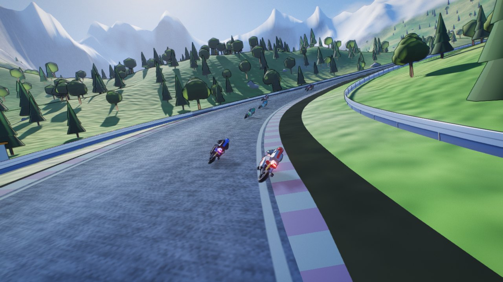
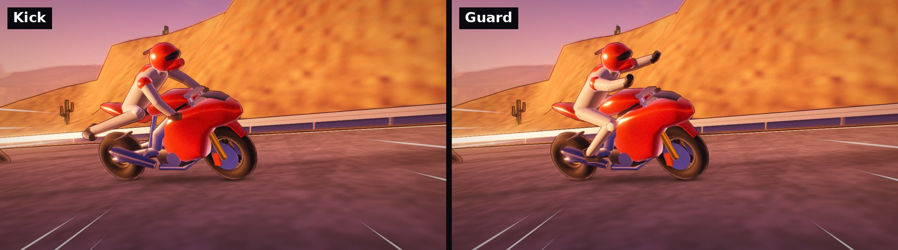
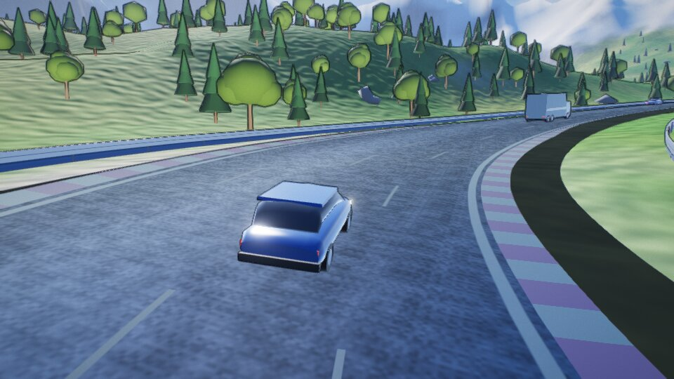
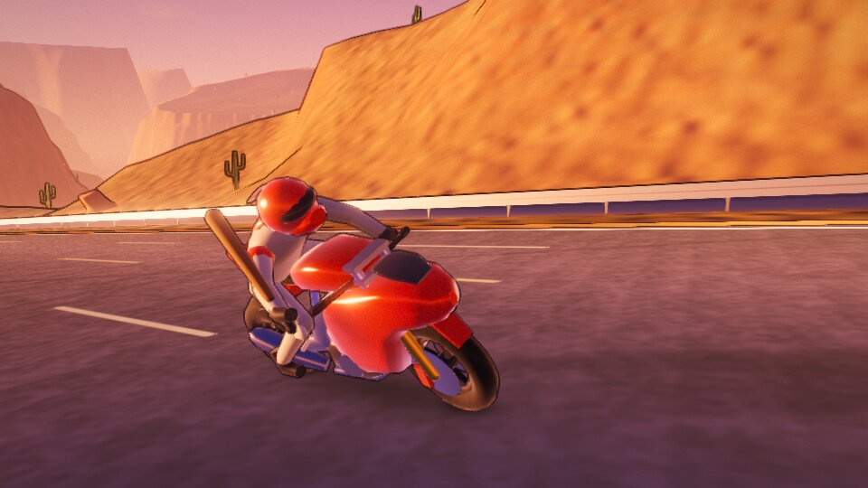

# racing

A 3D motorcycle combat racer for the browser: eight riders, three laps,
three tracks, boost, slipstream and fists. Rust and wgpu compiled to
WebAssembly, rendered through WebGPU with a WebGL2 fallback.



## Play

```
python3 -m http.server
```

Open http://localhost:8000/web/. The built bundles in `web/pkg-webgpu` and
`web/pkg-webgl2` are committed, so no build is needed to play. Add
`?backend=webgl2` to force the fallback renderer.

| Action | Keyboard | Gamepad |
|---|---|---|
| Throttle | W / ↑ | RT or A |
| Brake / reverse | S / ↓ | LT |
| Steer | A D / ← → | left stick |
| Boost | Shift or Space | RB |
| Punch | X or J | X |
| Kick | Z or K | B |
| Guard (hold) | Q or L | LB |
| Camera | C | Y |
| Pause | Esc or P | Start |
| Restart | R | |

## How it plays

- **Goal:** finish three laps ahead of seven rivals. Position, lap, lap time,
  best lap, a minimap and a results table track the race.
- **Handling:** speed-dependent steering with lean, tyre grip that lets go if
  you carry too much speed into a corner, braking, grass that slows you down
  and Armco barriers that crash you if you hit them hard.
- **Boost** drains while held and refills slowly; riding in a rival's wake
  gives a slipstream tow.
- **Combat:** punch a rider alongside to unsettle them, or kick: slower to
  wind up and longer reach, but it hits much harder. Hold guard to soak most
  of a hit (you ride slower and can't boost or strike while it is up). Raise
  it just as a hit lands to parry: the attacker is stunned and wobbles.
  Clean hits top up your boost, and knocking a rider off fills it. Crashed
  riders get back on after a couple of seconds.
- **Start:** hold the throttle about two-thirds open as the lights go out for
  a perfect launch and a little boost; flat out spins the rear tyre.
- **Riding:** the bike sits on working suspension (it dives under braking,
  squats on the gas and soaks up landings), the rider hangs off in corners
  and tucks in when you're flat out for a little more top speed, and
  overtakes earn a sliver of boost.
- **Difficulty:** pick Easy, Normal or Hard in the menu (remembered between
  visits). It changes the field, not your bike: rivals' pace and cornering
  nerve, how often they attack, block and parry, how hard their hits land on
  you, and how much the pack waits for you (Easy) or never does (Hard).
- **Rivals** race the same physics with their own lines, skill and aggression.
  No two hold the same pace: each drifts between pushing and cruising every
  few seconds, and now and then one brakes too early into a corner, so the
  pack strings out and bunches up again.
- **Fights come in waves:** the race opens clean, then the pack turns rough
  (a toast says so) and the angriest riders hunt you: they drop back or close
  up to ride alongside and swing at you. After a spell it settles back into
  clean racing, and round again (Hard brawls longer and rests less). Hit a
  rider cleanly and they hold a grudge whatever the mood.
- **Tracks:** each has a wide straight (the road opens out by a lane each
  side) with striped kickers on its shoulders, and tight hairpins at set
  points. Hit a kicker at speed and the bike flies for a second or more;
  line it up straight to land riding.
- **Traffic:** cars, vans and trucks use the road both ways, two lanes each
  direction. Touch one at speed and you are thrown over it; a rival shoving
  you into one counts as their knock-off. Skim past within a metre and a half
  for a near miss and a sliver of boost (more for oncoming cars). Rivals
  dodge traffic too, but not always.
- **Weapons:** some rivals carry a club or a chain: longer reach, harder
  hits, a few uses before it breaks. Knock an armed rider off, or parry their
  swing while bare-handed, and the weapon is yours. Crash and you drop it.
- **Hits land:** a landed blow freezes the action for a few hundredths of a
  second, harder for knock-offs and wrecks, so contact reads.
- **Season:** each finish pays prize money for your place, your knock-offs
  and your near misses (Hard pays most). Spend it in the garage on the menu:
  engine (pull and top speed), handling (grip) and armour (hits cost less
  balance), three levels each. Progress is kept in the browser.






## Look

One palette and one list of race events drive the scene, the post finish
and the HUD: ink outlines drawn from the depth buffer, anime-style impact
frames on hits and crashes, inked speed lines while boosting, per-track
split tone and grain, and a track accent that runs from the menu to the
minimap. See [docs/design-system.md](docs/design-system.md).

## Layout

- `crates/sim` — fixed-tick clock, deterministic RNG, small pools
- `crates/game` — tracks (spline centreline, banking, elevation, terrain),
  bike physics, race rules, AI rivals, scenery placement
- `crates/render` — the wgpu renderer (`style.rs` is the palette): HDR scene with sun shadows, PBR-ish
  shading, sky and fog, water, instanced scenery with LODs, particles,
  bloom, tone mapping, colour grade and FXAA, with dynamic resolution
- `crates/runtime` — the session the browser and native tools share: fixed
  120 Hz simulation with interpolation, chase camera, effects, HUD snapshot;
  `shot` renders screenshots and frame-time benches natively
- `crates/web` — wasm-bindgen entry points for the page
- `web/` — page, loader, HUD, menus, audio; `design.js` holds the page's
  half of the design system (tokens and the cue direction table)

## Build and check

```
bash web/build.sh                          # both wasm bundles
cargo run --release -p runtime --bin shot -- shots 1280 720
cargo run --release -p runtime --bin shot -- --bench 1280 720
```

`WGPU_BACKEND=gl` runs the native tools through the GLES path the WebGL2
bundle uses. Frame-time notes are in [docs/perf.md](docs/perf.md).

Gate:

```
cargo fmt --all --check
cargo clippy --workspace --all-targets -- -D warnings
cargo clippy -p web --target wasm32-unknown-unknown --no-default-features --features webgl2 -- -D warnings
cargo test --workspace
(cd web && npm test)
```
