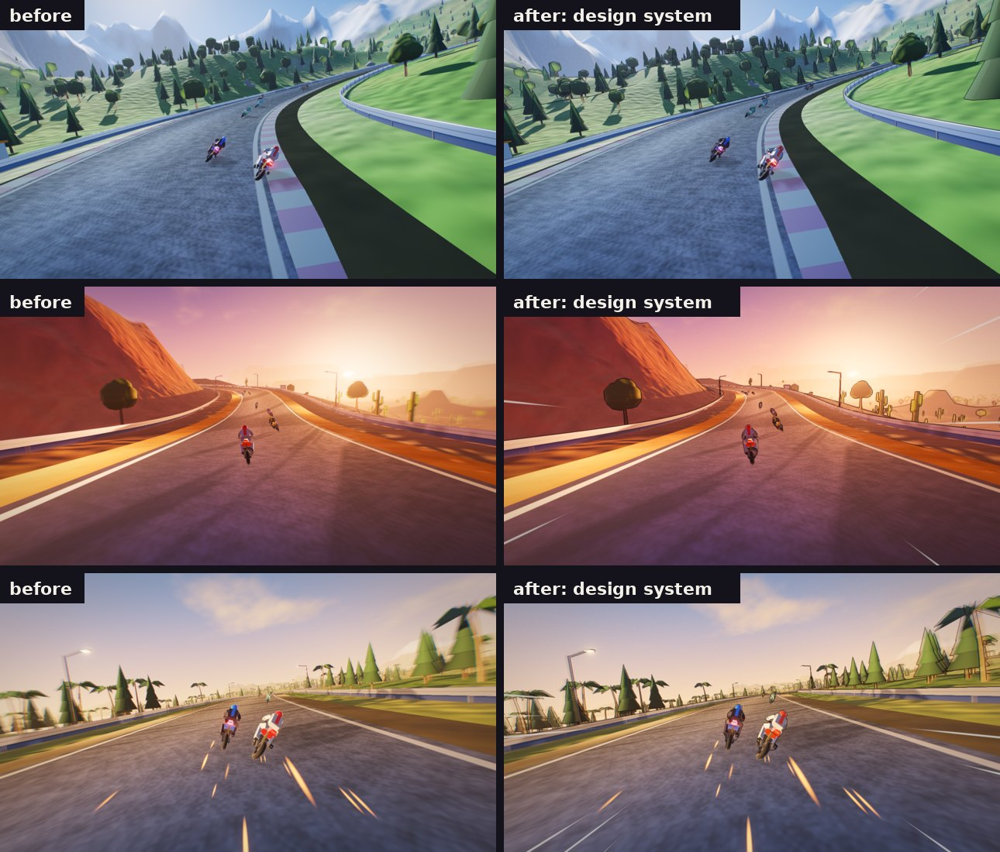
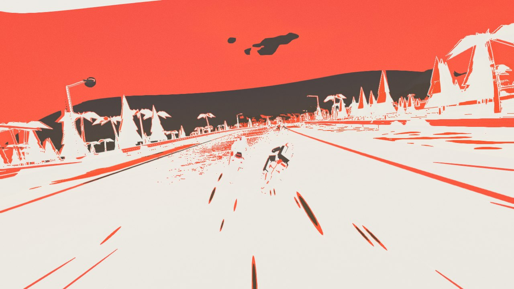
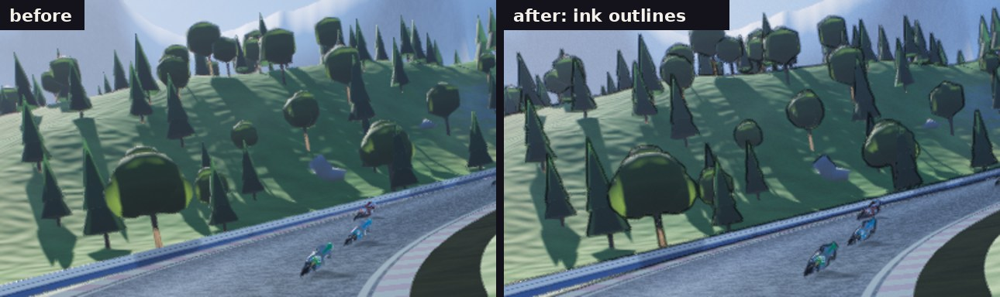

# Design system

The look borrows the production habits of the noroi-iwai prototype (a
frame-driven anime fight scene): the clock leads, the picture declares what
happens, and every effect answers the same small set of events. Here is what
that means for a racer.

## Lessons and where they live

1. **One clock, one list of events.** The 120 Hz simulation is the master
   clock. It raises cues (wall hit, contact, punch landed, crash, lap,
   overtake, finish), and everything that reacts reads from that one stream:
   the 3D effects and impact frames in `crates/runtime`, and the page's
   toasts, sounds and edge flashes through one table, `DIRECTION` in
   `web/design.js`. Change how a crash feels in one place.
2. **Build the real thing, then stylise it.** The scene is still lit,
   shadowed and fogged properly; a post pass then draws ink outlines from the
   depth buffer (`ink_line` in `crates/render/src/shaders/post.wgsl`).
   Reversed-Z depth is linear across flat surfaces, so its second difference
   is near zero on roads and slopes and spikes at silhouettes and creases.
   Lines thin with distance and skip the sky.
3. **Impact frames.** A landed punch, being hit, a crash or a hard wall hit
   holds a three-tone frame (ink, hot red, paper) for about 50 ms, lets the
   picture through for a beat, then holds again (`Session::impact_frame`).
   Players who ask their OS for reduced motion get none, and no edge flashes.
4. **Speed reads as drawing, not just blur.** While boosting, thin paper-tone
   streaks are re-inked twelve times a second around the frame edge, on top
   of the existing radial smear and chromatic fringe.
5. **A TV-anime finish.** Per-track split tone (cool or warm shadows against
   the highlights) and seeded film grain sit after the tone map, alongside
   the bloom, vignette and grade that were already there.
6. **One palette.** `crates/render/src/style.rs` owns the colours: ink,
   paper, hot, gold, boost, good, plus each track's accent. The player's
   bike and the boost flames are painted from it, the impact frames use it,
   and the wasm hands it to the page as CSS custom properties
   (`style_css`), which colour the HUD, menus, tach and minimap. The accent
   follows the track you pick.

## Switches

- `?ink=0` on the page turns the outlines off.
- `prefers-reduced-motion` turns off impact frames and edge flashes.
- `Settings { ink, flashes }` in the renderer for native tools.

## Cost

The outline, speed-line, split-tone and grain work is a handful of extra
texture reads in the composite pass, which already ran: no extra passes or
draw calls. On the CPU renderer used for the numbers in
[perf.md](perf.md) it adds about 0–6 ms at 1280×720 (3–5 %).
